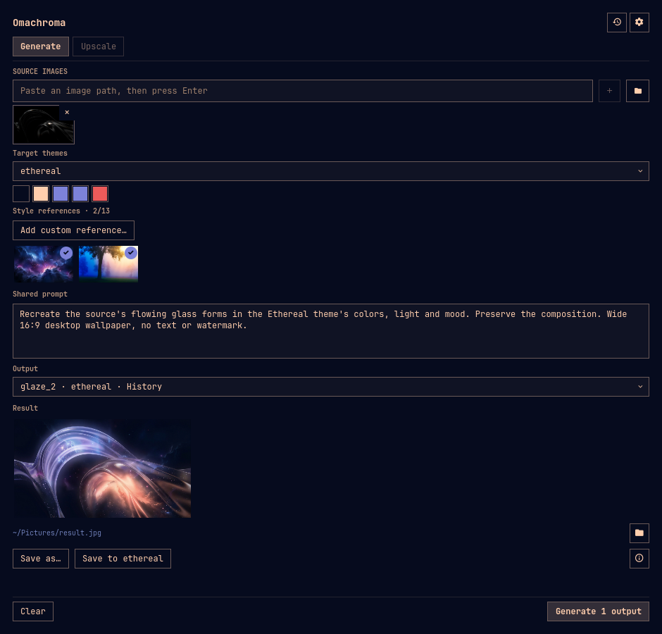
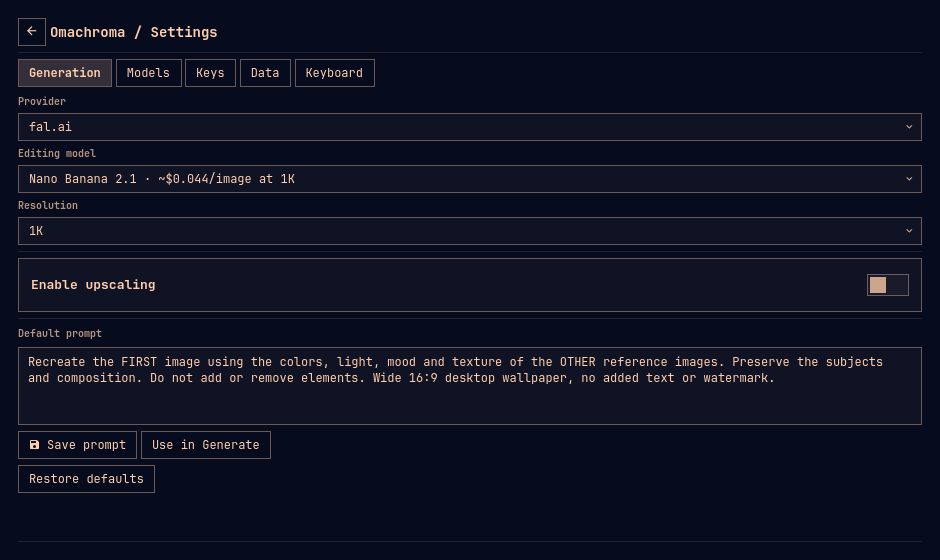

# Omachroma

Turn an image into wallpapers that fit your Omarchy themes. Use your own style
references, generate a batch across several themes, or upscale an existing image.



Omachroma is a community plugin for Omarchy's Quickshell shell. It uses fal.ai
or OpenRouter for image editing; upscaling uses fal.ai. Bring your own provider
keys. Generation and upscaling are paid provider operations.

## Install

The public repository is being prepared. The command below becomes available
when the first public release is published.

```bash
omarchy plugin add https://github.com/miguelcorderocollar/omachroma.git --enable
```

For a local checkout, link its root into the native plugin directory:

```bash
ln -s /absolute/path/to/omachroma ~/.config/omarchy/plugins/mikelon797.omachroma
omarchy-shell shell rescanPlugins
omarchy plugin enable mikelon797.omachroma
```

Do not replace an existing plugin directory blindly. Validate the real checkout,
not the symlink, with `omarchy plugin validate /absolute/path/to/omachroma`.

Open **Omachroma** in the application launcher, or run:

```bash
omarchy-shell shell summon mikelon797.omachroma
```

### Requirements

- Omarchy with the Quickshell plugin API, schema version 1. This release was
  checked on Omarchy 4.0.4-1 and Quickshell 0.3.1-1 on 14 October 2026.
- Python 3.11+ and ImageMagick 7, providing the `magick` command.
- System `python-gobject` and a desktop FileChooser portal for image selection
  and **Save as**.
  Normal Omarchy sessions provide these; `xdg-desktop-portal-gtk` is one
  FileChooser backend. Export deliberately uses `/usr/bin/python3` so it can
  load the system PyGObject bindings.
- `wl-copy` for colour copying and `xdg-open` for opening result folders.

No pip installation, privileged installer or background system service is needed.
Check local prerequisites without contacting a provider:

```bash
python3 generate-theme-wallpaper.py --doctor
```

### Optional floating-window rule

Omachroma uses a normal application window so you can resize or tile it. The
class name of the QML window type does not force floating in Hyprland. To start
it floating and opaque, add this rule to your user Hyprland bindings file:

```lua
o.window({ title = "^Omachroma$" }, { tag = "+floating-window", opacity = "1 1" })
```

Reload with `hyprctl reload`, then check `hyprctl configerrors`. Omachroma does
not edit your Hyprland configuration. On Omarchy, Super+T toggles floating and
Super+W closes the window. Closing the window keeps the plugin loaded, so a
running job can finish. Stop explicitly before disabling or removing the plugin.

## Use

1. In Settings → Keys, save your fal.ai or OpenRouter key. Choose a model in
   Generation. Enable upscaling there if wanted; it requires a fal key, even
   with OpenRouter editing. Its controls stay hidden while disabled.
2. Add source images and select target themes. Each source/theme pair produces
   one output. Two sources and three themes make six outputs.
3. Select references for each theme. Theme backgrounds supply the initial
   references; add your own when a theme has none. Edit the shared prompt.
4. Review the output count and rates, then Generate. Jobs run sequentially.

Completed outputs automatically save into their target theme's wallpaper folder.
They do **not** change your active desktop wallpaper or theme. Use the native
Omarchy wallpaper picker to apply one. **Save to theme** and **Save remaining**
can retry saves or save a retained result into another selected theme. **Save as**
exports a copy to a filename and location you choose, with JPG, PNG or WebP
conversion when needed.

**Output** selects a source/theme result. Clicking its thumbnail enlarges it.
The Generate output count includes only outputs remaining for the current recipe.
Changing inputs, references, prompt or model starts a new recipe. **New variation**
regenerates the selected output and may incur another charge.

Batches stop on failure or Stop; remaining outputs are not submitted. Completed
edits survive an upscale failure. Jobs have a 15-minute deadline. Stopping ends
local work; a provider may still bill work it received. There are no automatic
paid retries. The selection is limited to 200 source/theme combinations.

History retains results, failures, cancellations and reported costs across app
sessions. **Clear** resets the current images, selected references and preview;
it preserves saved files, History, target themes and the prompt. Batch recipe
tracking lasts for the current application session.

In Upscale, choose an existing image and an engine. AuraSR is fixed at 4×;
the bundled alternatives support 2× and 4×. A selected target theme receives
the completed output automatically. Without a target theme, the result stays
in the app's result folder until you export or save it. The Upscale workspace is
disabled when upscaling is switched off.

The file chooser remembers the last image folder and export folder separately.
Keyboard shortcuts are listed in Settings → Keyboard. Tab and Shift+Tab move
between controls, Enter/Space activate, and Escape closes a dialog before
returning to the workspace. Ctrl+, opens Settings, Ctrl+H opens History,
Ctrl+O chooses images, and Alt+G runs the primary action from the workspace.
Generation shortcuts are inactive inside Settings, History and modal dialogs.



## Models and pricing

Settings separates Generation, Models, Keys, Data and Keyboard. Models includes
price refresh, preferred defaults, hiding/showing choices, and a validated
configuration editor that opens in a modal dialog. Your configuration can add
editing models and upscalers that use an existing request adapter. It can also
provide manual rates and generation defaults. See [model configuration](docs/models.md).

**Refresh prices** checks the known models using your provider keys. It sends
model IDs, not your images or generation prompt. Successful responses are cached
locally. Failed refreshes retain previous metadata; dates and warnings tell you
what was refreshed. Bundled dated rates remain available without a network.
Manual price overrides take precedence over fetched rates.

Prices may be per image, image token, megapixel or compute time. Resolution,
quality, references and provider routing can change the bill. A batch estimate
appears only when the available metadata supports it; otherwise the app shows
rates and explains that the total varies. Cached metadata cannot guarantee
that a model is still available.

Final costs use only explicit provider-reported amounts. Partial costs and
"Final cost not reported" remain separate from estimates. Provider dashboards
are the billing record. See [pricing behavior](docs/pricing.md).

## Privacy and stored files

Omachroma sends the selected images, references and generation prompt to the
chosen editing provider. Upscaling sends an image to fal.ai. Upload preparation
removes image metadata. Provider retention and billing policies still apply.
There is no plugin telemetry.

New installations store data in `$XDG_DATA_HOME/omachroma`, normally
`~/.local/share/omachroma`. Machines upgrading from OmaPaper continue using the
existing `omapaper` directory so previous history/result paths stay valid.
Settings displays the active data directory. Files include:

- `.env`: saved provider keys, written atomically with mode 0600 through stdin.
  Keys do not appear in process arguments or shell settings. This is ordinary
  local storage, not encrypted storage. Environment keys take precedence.
- `config.json`: generation settings and your default prompt.
- `models.json`: your model choices, hidden entries, defaults and manual rates.
- `catalog-cache.json`: last-good provider metadata and check dates.
- `picker.json`: remembered image-selection and export folders.
- `results/`: generated images and per-result prompt text.
- `history/` and `current-job.json`: bounded metadata and preview selection.
  History includes source paths and outcomes, but no keys or prompts.

Settings includes a bounded storage-usage check and an **Open app data folder** action for deliberate cleanup. The scan reads file sizes, not file contents. Result folders accumulate until you remove them. **Clear** is not disk cleanup.
You can remove unneeded generated result folders using your file manager; missing
results are identified in History. Back up images you want before doing so.
Keys can be removed separately in Settings. An environment key stays active
until you remove it from the environment and restart the shell.

Saved theme wallpapers use unique names under
`~/.config/omarchy/backgrounds/<theme>/`. Existing wallpapers are preserved.
Older OmaPaper wallpaper names and result files remain usable after upgrading.

## Remove

Stop any job first. Run the bundled removal helper from the installed plugin:

```bash
bash ~/.config/omarchy/plugins/mikelon797.omachroma/uninstall.sh --yes
```

It removes only Omachroma's managed launcher and asks the native plugin manager
to remove the plugin. Keys, configuration, history, results and theme wallpapers
remain intact. A custom launcher or symlink at the launcher path is left alone.
If you prefer native commands, remove the managed launcher before removing code:

```bash
python3 ~/.config/omarchy/plugins/mikelon797.omachroma/generate-theme-wallpaper.py --remove-launcher
omarchy plugin remove mikelon797.omachroma --yes
```

Native plugin removal alone does not clean up the registered launcher. For full
personal-data cleanup, first remove keys in Settings, then deliberately remove
the active data directory shown there. Do not delete your entire theme wallpaper
folders. Remove individual generated wallpapers through the file manager.

## Development

From the checkout root:

```bash
./scripts/test.sh
omarchy plugin validate .
python3 generate-theme-wallpaper.py --list-themes
```

Tests use temporary files and mocked providers. They make no paid API calls.
See [design](DESIGN.md), [changelog](CHANGELOG.md) and the [release checklist](docs/releasing.md).

MIT license. Copyright 2026 Miguel Cordero. Omachroma is maintained independently
and is not an official Omarchy plugin. README screenshots use an isolated profile showing a saved glaze wallpaper
and its Ethereal result. The source/result are excluded from the reference
strip; the visible references are distinct stock theme images. No generation
was run for the screenshots. The reusable [demo scripts](scripts/demo/README.md)
prepare isolated profiles and captures for screenshots or code-driven videos.
